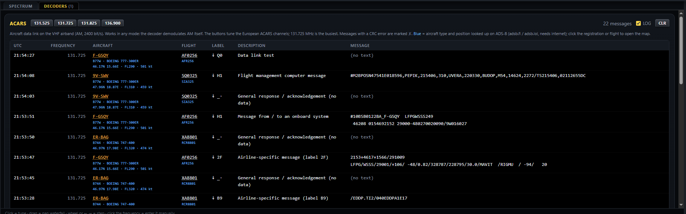

# RADIMCOM

A receiver for RTL-SDR dongles and LimeSDR Mini controlled from a web browser: HF through an upconverter, VHF/UHF directly.
The screen looks like a transceiver: S-meter, 7-segment displays, spectrum, waterfall and function keys.
Up to four SDRs work as four VFOs (A, B, C, D), switched with a single button.


## Features

- **Up to four VFOs, A–D.** Each VFO has its own SDR (RTL-SDR or LimeSDR Mini, selected by serial number)
  and its own settings. All frequencies are shown side by side: the active VFO is lit, inactive ones are grey
  but show the actual tuned frequency. The waterfall of every VFO keeps running, so its history is visible
  right after switching. With fewer than four SDRs the remaining VFO windows stay in place, greyed out ("NO SDR").
- **RF GAIN and SQUELCH sliders** under each VFO display.
- **Modes:** AM, FM, WFM, LSB, USB and CW with selectable filter width.
- **WFM stereo** (19 kHz pilot, **ST** flag) and **RDS**: station name (PS), RadioText, PI, PTY, TP/TA and clock (CT).
- **Squelch** for AM, FM and WFM, each mode with its own level. It decides every ~8 ms, so it does not cut off
  the start of a transmission (airband). The level is marked on the S-meter with a yellow tick.
- **Spectrum and waterfall** with 1×–32× zoom.
- **Decoders:** FT8, WEFAX (radio fax with automatic format detection), CW (Morse with AFC and speed estimation), RTTY (Baudot, automatic shift 90–1000 Hz, speed 45.45/50/75/100 Bd and polarity), SSTV (colour images, 14 modes, VIS) and ACARS (aircraft data messages on 131.725 MHz and others, AM, MSK 2400 bit/s, CRC check; aircraft type and position from adsb.fi / adsb.lol).
- **Daily logs:** the LOG checkbox in each decoder card writes to `data\logs\<decoder>_YYYY-MM-DD.txt` (UTC, one line per message; WEFAX/SSTV log the names of saved images), ACARS to `data\acars\acars_YYYY-MM-DD.txt`.
- **Frequency memories** (MEM) with favourites and import from SDR# (`frequencies.xml`).
- **Upconverter:** HF is tuned via the LO (e.g. 100 MHz). For a VFO with a manual converter switch, crossing
  30 MHz shows a warning whether the converter must be switched on (CONV) or set to BYPASS.
- **Audio** starts automatically when the page opens and comes from the active VFO.
- **CUE:** keep listening to other VFOs at a separate CUE level while one VFO is selected;
  MAIN and CUE volume faders, stereo level meter, MUTE.
- **REC:** records the audio of the selected VFO to a WAV file.
- **TX with LimeSDR** (optional, off by default), see below.


## Requirements

- Windows and Python 3.9+. The simplest way is the installer package (`install.bat`, see `installer\INSTALL.txt`),
  which creates `.venv` and installs everything. By hand:

  ```bash
  pip install -r installer\requirements.txt
  pip install --no-deps PyFT8
  ```

  (`flask`, `numpy`, `scipy`; `PyFT8` is needed only for the FT8 decoder.)

- RTL-SDR dongles with the WinUSB driver (installed with Zadig).
- LimeSDR Mini with the FTDI D3XX driver.

Third-party binaries are **not in this git repository** (folders `lib\` and `drivers\` are in `.gitignore`).
The installer package (`RADIMCOM_install_v<version>.zip`, download it from
[Releases](https://github.com/om2amr/RADIMCOM/releases)) contains them all. When running from the git sources,
put them there yourself:

| File | Purpose | Source |
|---|---|---|
| `lib\librtlsdr.dll`, `lib\libusb-1.0.dll` | required for RTL-SDR | Windows release of the RTL-SDR Blog driver (`rtl-sdr-blog`, supports the V4) |
| `lib\LimeSuite.dll` | only for LimeSDR | PothosSDR (`C:\Program Files\PothosSDR\bin`); if it is not in `lib\`, it is loaded from the PothosSDR installation |
| `drivers\zadig.exe` | WinUSB driver for RTL-SDR | zadig.akeo.ie |
| `drivers\FTD3XXDriver_WHQLCertified_v1.3.0.4_Installer.exe` | D3XX driver for LimeSDR | FTDI (ftdichip.com, D3XX drivers) |

`installer\make_installer.py` takes the RTL-SDR DLLs from `lib\`, `LimeSuite.dll` from PothosSDR and the drivers
from `Downloads` on this PC.
- For FT8 the PC clock must be accurate (±1 s).

## Running

```bash
python app.py
```

On Windows just double-click `start.bat`. Then open **http://localhost:8434** in the browser.

- If `data\vfos.json` exists, the **VFO launcher** (`launcher.py`) starts. It opens a separate receiver on its
  own port for each VFO and serves the page itself on port 8434. Closing the launcher also closes the receivers.
- Without `vfos.json` a single receiver runs with the settings from `data\config.json`.
- Only one such server can run at a time, because the dongles are shared.
- If the browser does not allow sound without a click, the page shows *"Click anywhere to start audio"*.
  Sound starts after the first click on the page.

## Controls

### Tuning

| Action | How |
|---|---|
| Switch VFO | **VFO-A … VFO-D** button or click on an inactive (grey) display |
| Enter a frequency | click on the active VFO display, type e.g. `7100` (kHz) or `145.5` (MHz), units `k` / `M` / `Hz` also work; Enter (Esc cancels) |
| Tune by one step | ← → arrow keys, or mouse wheel over the spectrum or waterfall (step set by STEP) |
| Tune by a digit | mouse wheel over a digit of a VFO display tunes by that digit's place (1 Hz … 1 GHz); works on inactive VFOs too, without switching |
| Tune to a point | click in the spectrum or waterfall |
| Move the band | drag with the mouse in the spectrum or waterfall |
| Filter width | drag the filter edge in the spectrum |
| Band | buttons in the groups HF HAM, HF BROADCAST, VHF / UHF HAM, OTHER (FM BCAST tunes the last FM station listened to) |

Hovering over the spectrum or waterfall shows the frequency under the mouse.

If a band or memory is outside the range of the active VFO, the receiver switches by itself to a VFO that can
receive it (e.g. an HF band to the VFO with the converter).

### VFO window

Each VFO window shows a status flag (USB icon = SDR running, WAIT / OPENING / CAL while starting,
OFFLINE on error or disconnection; hover for details), the mode, a **CUE** flag (click to toggle CUE for
that VFO without switching), the frequency display and the **RF GAIN** and **SQUELCH** sliders with their values
(squelch only in AM/FM/WFM). The sliders work on inactive VFOs too, without switching.

### Frequency display

- Below 30 MHz in **kHz**: `7.016.500` kHz, the first dot separates thousands, the second is the decimal point.
- From 30 MHz in **MHz**: `439.475.000` MHz.
- The last three (smaller) digits are Hz.

### Function keys

- **MODE**: demodulation. **FILTER**: bandwidth for the current mode.
- **GAIN**: AGC switches automatic tuner gain on/off (manual gain with the RF GAIN slider or in SET).
- **STEP**: tuning step (10 Hz – 10 kHz). **ZOOM**: spectrum and waterfall span (1×–32×).
- **DECODE**: turns on the FT8, WEFAX, CW, RTTY, SSTV or ACARS decoder. The panels are in the
  **DECODERS** tab next to SPECTRUM; turning a decoder on opens it, a green dot signals a new message/image.
  Every panel has a LOG checkbox for the daily log:
  - FT8: band buttons (160 m – 10 m) and CLR.

    

  - WEFAX: stations (DWD Pinneberg 3855/7880/13882.5 kHz, Northwood GYA 2618.5/4610/8040/11086.5 kHz), LPM/IOC (Auto or fixed),
    NEW and PNG; a click in the image sets that spot as the left edge. Finished images are saved to `data\wefax\`.
  - CW: TUNE switches to CW and tunes to the detected tone, CLR clears the text.
  - RTTY: SHIFT, BAUD and POLARITY (Auto or fixed), CLR.
  - SSTV: frequencies (80m–10m, ISS FM), mode selection (Auto by VIS), STOP, PNG and a gallery of recent
    images (saved to `data\sstv\`). Modes Martin M1/M2, Scottie S1/S2/DX, Robot 36/72, PD 50–290;
    AFC and slant correction are automatic. Filter at least 2.7 kHz.
  - ACARS: channel buttons (131.525 / 131.725 / 131.825 / 136.900 MHz), CLR; click the registration or flight to open the ADS-B map.

    

- **AUDIO**:
  - STEREO: WFM stereo on/off (mono = less noise on weak stations).
  - NOTCH: automatic notch for AM/LSB/USB, finds and removes steady tones (whistles, carriers) by ~40 dB and
    leaves speech. It also feeds the SSTV decoder, so turn it off for SSTV.
  - ALC: automatic audio level in AM/LSB/USB/CW; off = fixed gain.
  - CUE: keep hearing this VFO (at the CUE level) when another VFO is selected.
- **Volume** (top right): vertical MAIN (active VFO) and CUE faders, stereo L/R level meter, the speaker icon
  below them is MUTE, and **REC** records the audio of the active VFO to a WAV file.
- **MENU → SET**: settings of the active VFO.
  - Squelch for the current mode.
  - Tuner gain (manual or automatic), RTL2832 digital AGC (RTL-SDR only).
  - Display width (sample rate).
  - Upconverter LO and ppm correction.
  - Bias-tee 4.5 V (if the SDR has it). Turn it on only when the upconverter or preamplifier really needs it.
  - Enable TX (LimeSDR only), see below.
  - S-meter calibration (S9 level) and waterfall colour range / offset.
  - RESET DONGLE.
  - Without `vfos.json` (single receiver) also the dongle selection and the upconverter mode (auto / on / off).
- **MENU → MEM**: frequency memories with groups, search and favourites. ＋ SAVE CURRENT stores the frequency,
  mode and width under a name and group; ★ marks a favourite.

The clock (top right) switches between local time and UTC with a click.

### Flags next to the S-meter

| Flag | Meaning |
|---|---|
| RX / TX | receiving; TX (red) while transmitting with the LimeSDR |
| mode, width | current demodulation and filter |
| SQL | squelch is on (shown only then); lit when open |
| ST | WFM only: lit when the stereo pilot is received |
| ALC | AM/SSB/CW: automatic audio level (grey = off) |
| CONV / BYPASS | required position of the manual upconverter switch (VFOs with upconverter mode auto) |

When squelch is on for an inactive VFO and it opens, that VFO's button lights up green.

## Configuration

### `vfos.json`: assigning dongles to VFOs

```json
{
  "port": 8434,
  "vfos": [
    { "name": "A", "serial": "SDR00001", "port": 8441, "config": "config_A.json",
      "note": "HF via upconverter",
      "init": { "upconv": "auto", "lo_offset_hz": 100000000, "ppm": 0 } },
    { "name": "B", "serial": "SDR00002", "port": 8442, "config": "config_B.json", "init": { "ppm": 0 } },
    { "name": "C", "serial": "SDR00003", "port": 8443, "config": "config_C.json", "init": { "ppm": 0 } },
    { "name": "D", "driver": "lime", "serial": "1D3C...", "port": 8444, "config": "config_D.json",
      "note": "LimeSDR, VHF/UHF direct" }
  ]
}
```

- `serial` is the dongle's serial number in EEPROM (for a LimeSDR its serial number, `driver: "lime"`).
- `port` is the port of that VFO's receiver. The page talks to it directly.
- `config` is the VFO settings file. On first start it is created from `config.json` plus the values from `init`.
  After that each VFO remembers its own tuning, mode, filters, squelch, gain and ppm.

### Initial setup: `setup_sdr.py`

```bash
python setup_sdr.py
```

The wizard (`setup.bat` on Windows) finds the connected RTL-SDRs and LimeSDRs and assigns them to VFO A, B, C, D:
the device for a VFO is chosen by number or by unplugging it for a moment (the wizard detects which one is
missing). Then it asks about the upconverter and ppm and writes `vfos.json`. If the dongles share the same serial
number (commonly `00000001`), it offers to write a unique number to the EEPROM. Old `vfos.json` and `config_X.json`
are moved to `data\config_backup\`. The receiver must be stopped during setup.

ppm correction can also be set later in the SET menu of each VFO.

### Transmitting (LimeSDR)

For a VFO with a LimeSDR, SET has an **Enable TX** switch (off by default). When enabled, PTT is
holding the space bar: in FM a test message from `data\tx_audio\test_message.wav` is sent (if it exists), otherwise a carrier.
Transmitting works only without the upconverter.

### Dongle serial numbers: `eeprom_tool.py`

```bash
python eeprom_tool.py
```

Lists the connected dongles and backs up their EEPROM to `data\eeprom_backup\`.

```bash
python eeprom_tool.py write INDEX SERIAL
```

Writes a new serial number. It must have the same length as the original. After writing, unplug and replug the dongle.

```bash
python eeprom_tool.py restore INDEX FILE
```

Restores the EEPROM from a backup.

### Importing memories from SDR#

```bash
python memories.py C:\sdrsharpSW\frequencies.xml
```

## Files

| File | Contents |
|---|---|
| `app.py` | receiver server (Flask): API, events (SSE) and audio |
| `launcher.py` | VFO A–D launcher |
| `sdr.py` | RTL-SDR via librtlsdr (ctypes) and DSP: tuning, filters, demodulation, squelch, waterfall |
| `rds.py` | RDS decoder |
| `ft8.py`, `wefax.py`, `cw.py`, `rtty.py`, `sstv.py`, `acars.py` | decoders |
| `daylog.py` | daily decoder logs |
| `memories.py` | memories and import from SDR# |
| `eeprom_tool.py` | reading, backing up and writing dongle EEPROM |
| `setup_sdr.py` | initial dongle setup wizard (`vfos.json`) |
| `lime.py` | LimeSDR via LimeSuite.dll (receive and transmit) |
| `static/` | web interface (`index.html`, `style.css`, `app.js`) |
| `paths.py` | data paths (`data\`), migration of data from older versions |
| `installer/` | building the installer package (`make_installer.py`) and the files it contains; the package is created in `dist\` |

## Data folder (`data\`)

RADIMCOM keeps two kinds of files apart:

- **Program** (main folder): code, web interface, libraries. Same on every PC; comes from git or the installer package.
- **Your data** (`data\` folder): your settings, memories, logs, saved images and backups. Different on every PC.

`data\` is never uploaded to GitHub (it is in `.gitignore`) and never packed into the installer, so your
personal data stays only on your PC, and an update or reinstall of the program does not touch it.
The paths are defined in `paths.py`.

| File / folder | Contents | Created by |
|---|---|---|
| `config.json` | settings for single-receiver mode and template for new VFOs | installer (template), moved here at first start |
| `vfos.json` | dongle assignment to VFOs (serial numbers, ports) | `setup_sdr.py` / `setup.bat` |
| `config_A/B/C/D.json` | settings of each VFO (frequency, mode, filters, squelch, gain, ppm, …), saved on every change | launcher at first start, from `config.json` + `init` |
| `memories.json` | frequency memories | MEM, import from SDR# |
| `logs\` | daily decoder logs `<decoder>_YYYY-MM-DD.txt` (UTC) | LOG checkbox in decoder cards |
| `acars\` | ACARS daily log `acars_YYYY-MM-DD.txt` (UTC) | ACARS with LOG on |
| `wefax\`, `sstv\` | saved WEFAX / SSTV images (PNG) | the decoders |
| `config_backup\<date_time>\` | previous `vfos.json` and `config_X.json` | `setup_sdr.py` before writing a new assignment |
| `eeprom_backup\` | dongle EEPROM backups (`.bin`) | `eeprom_tool.py`, `setup_sdr.py` |
| `tx_audio\test_message.wav` | optional FM test message for TX | you (copy a WAV there) |

**Older versions** kept these files in the main folder. At the first start of a version with `data\` they are moved
there automatically (`paths.py`). A file is moved only if it is not in `data\` yet; an existing file in `data\` is
never overwritten (a leftover copy then stays unused in the main folder).

**Backup:** close the receiver first (it saves `config_X.json` while running), then copy or zip the whole `data\`
folder somewhere outside the RADIMCOM folder.

**Reinstall / update:**
- Unzipping a new installer package over the old folder keeps `data\` (the package has no `data\`).
- In a new, empty folder: copy the backed-up `data\` into it before the first start.
- In `install.bat`, answer **N** to "Run the SDR setup now" to keep the existing VFO assignment; with Y a new
  assignment is created and the old one is moved to `data\config_backup\`.
- Do not run two RADIMCOM folders at the same time: they share the dongles and port 8434.
