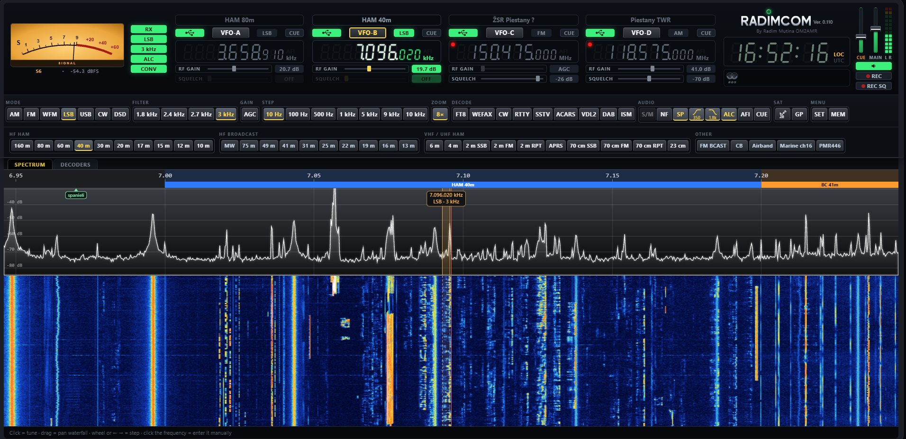
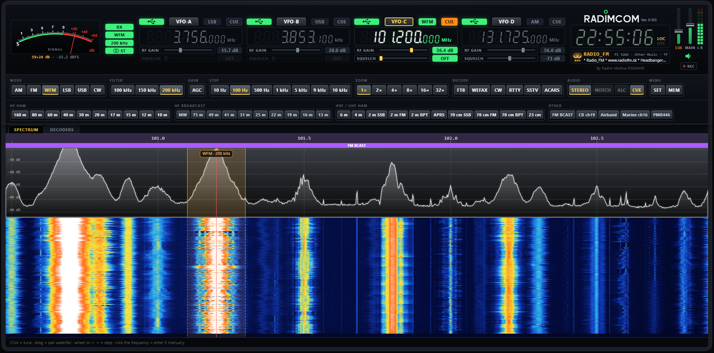
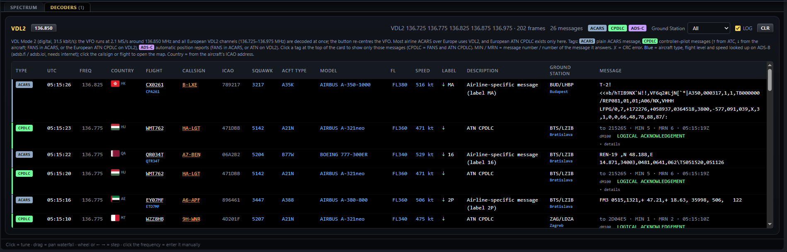
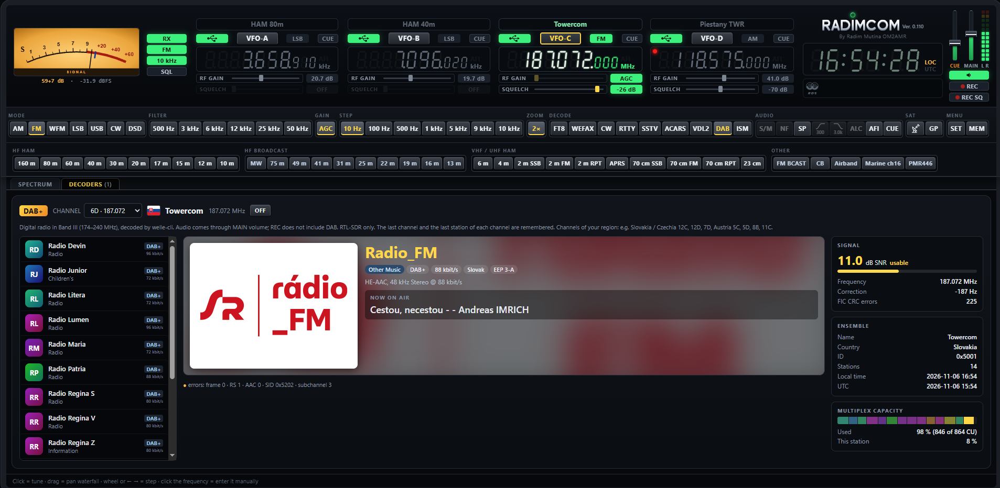
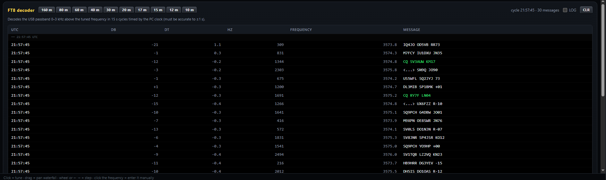
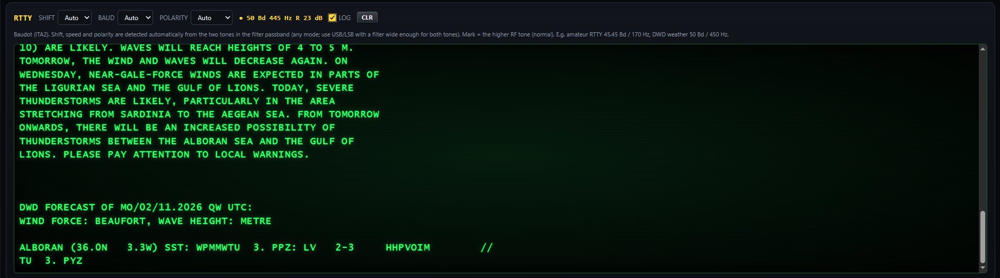
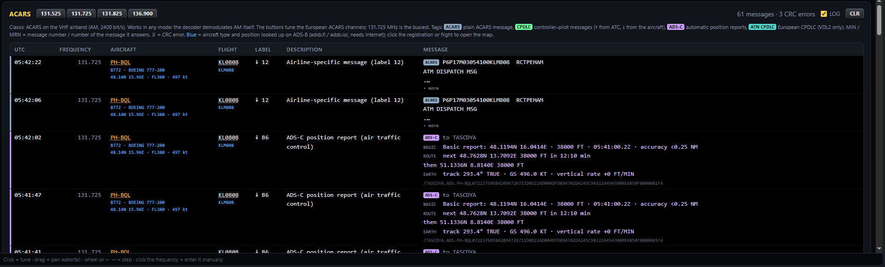
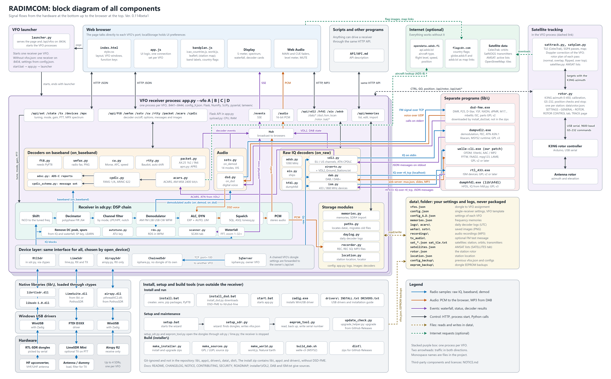

# RADIMCOM

A receiver for RTL-SDR dongles and LimeSDR Mini controlled from a web browser: HF through an upconverter, VHF/UHF directly.
The screen looks like a transceiver: S-meter, 7-segment displays, spectrum, waterfall and function keys.
Up to four SDRs work as four VFOs (A, B, C, D), switched with a single button.



> [!IMPORTANT]
> **The DSD mode (digital voice) needs one extra installation step.** Its decoder, DSD-FME, is **not in the install zip or the upgrade zip**.
> After installing RADIMCOM, run **`install_dsd.bat`** once in the RADIMCOM folder, read the patent notice and type YES to download the decoder.
> Without this step the DSD mode stays silent; everything else in RADIMCOM works without it.
> DSD is a **first test version** and still needs more testing, see [DSD: digital voice](#dsd-digital-voice).

## Features

- **Up to four VFOs, A–D.** Each VFO has its own SDR (RTL-SDR or LimeSDR Mini, selected by serial number)
  and its own settings. All frequencies are shown side by side: the active VFO is lit, inactive ones are grey
  but show the actual tuned frequency. The waterfall of every VFO keeps running, so its history is visible
  right after switching. With fewer than four SDRs the remaining VFO windows stay in place, greyed out ("NO SDR").
- **VFO chaining:** one dongle can serve several VFOs, e.g. one dongle for VFO A–D, or two dongles with two VFOs
  each. A chained VFO listens anywhere inside the band its dongle receives and shows a green CHAIN flag
  (see [VFO chaining](#vfo-chaining-one-dongle-for-several-vfos)).
- **Memory name or band plan above each VFO:** a frame on top of the VFO window shows the name of the memory on its
  frequency, otherwise the band plan label for that frequency, e.g. `HAM 70cm` (in grey).
- **RF GAIN and SQUELCH sliders** under each VFO display.
- **Modes:** AM, FM, WFM, LSB, USB and CW with selectable filter width.
- **WFM stereo** (19 kHz pilot, **ST** flag) and **RDS**: station name (PS), RadioText, PI, PTY, TP/TA and clock (CT).
- **Squelch** for AM, FM and WFM, each mode with its own level. It decides every ~8 ms, so it does not cut off
  the start of a transmission (airband), and closes about 25 ms after the signal drops below the level. The level is marked on the S-meter with a yellow tick.
- **Spectrum and waterfall** with 1×–32× zoom.
- **Decoders:** FT8, WEFAX (radio fax with automatic format detection), CW (Morse with AFC and speed estimation), RTTY (Baudot, automatic shift 90–1000 Hz, speed 45.45/50/75/100 Bd and polarity), SSTV (colour images, 14 modes, VIS) and aircraft data link: ACARS (131.725 MHz and others, AM, MSK 2400 bit/s) and VDL2 (VDL Mode 2, EU or US channels 136.100–136.975 MHz, all channels of the region at once, via dumpvdl2), with CPDLC (FANS-1/A and European ATN) and ADS-C position reports decoded to plain text; aircraft type, flight level and speed from adsb.fi / adsb.lol, country flag from the ICAO address. See [Aircraft data link](#aircraft-data-link-acars-vdl2-cpdlc-ads-c).
- **DAB / DAB+ digital radio:** the **DAB** key in DECODE: station list of the ensemble, DLS text, slideshow, audio,
  signal, ensemble and capacity panels, remembered channel and station, via welle-cli. See [DAB / DAB+ digital radio](#dab--dab-digital-radio).
- **Digital voice (first test version):** the **DSD** key in MODE: DMR, P25, D-Star, YSF, NXDN, dPMR, M17 and more, with a list of calls, via DSD-FME
  (**separate download: run `install_dsd.bat`**). See [DSD: digital voice](#dsd-digital-voice).
- **ISM decoder:** the **ISM** key in DECODE: devices on 433 and 868 MHz, such as weather sensors, remote controls and tyre sensors, via rtl_433.
- **Satellite tracking:** a K3NG antenna rotor over USB and Gpredict, which is in the package, with Doppler frequency tuning of the VFO. See [Satellite tracking](#satellite-tracking-antenna-rotor-and-gpredict).
- **Remove DC peak** and **remove spurs** from local sources, in the waterfall and in the received signal.
- **Daily logs:** the LOG checkbox in each decoder card writes to `data\logs\<decoder>_YYYY-MM-DD.txt` (UTC, one line per message; WEFAX/SSTV log the names of saved images), classic ACARS to `data\acars\acars_YYYY-MM-DD.txt` and VDL2 to `data\acars\vdl2_YYYY-MM-DD.txt`.
- **Frequency memories** (MEM) with favourites and import from SDR# (`frequencies.xml`).
- **Upconverter:** HF is tuned via the LO (e.g. 100 MHz), see [Shortwave (HF) reception](#shortwave-hf-reception-with-an-upconverter). For a VFO with a manual converter switch, crossing
  30 MHz shows a warning whether the converter must be switched on (CONV) or set to BYPASS.
- **Audio** starts automatically when the page opens and comes from the active VFO.
- **CUE:** keep listening to other VFOs at a separate CUE level while one VFO is selected;
  MAIN and CUE volume faders, stereo level meter, MUTE.
- **REC and REC SQ:** record the audio of the selected VFO to MP3 files in `data\recordings`: everything, or only while the squelch is open.
- **TX with LimeSDR** (optional, off by default), see below.



## Requirements

- Windows and Python 3.9+. The simplest way is the installer package (`install.bat`, see `installer\INSTALL.txt`),
  which creates `.venv` and installs everything. By hand:

  ```bash
  pip install -r installer\requirements.txt
  pip install --no-deps PyFT8
  ```

  (`flask`, `numpy`, `scipy`, `pyserial`, `lameenc`; `PyFT8` is needed only for the FT8 decoder, `pyserial` only for the antenna rotor, `lameenc` only for recording.)

- RTL-SDR dongles with the WinUSB driver (installed with Zadig).
- LimeSDR Mini with the FTDI D3XX driver.

Third-party binaries are **not in this git repository** (folders `lib\` and `drivers\` are in `.gitignore`).
The installer package (`RADIMCOM_install_v<version>.zip`, download it from
[Releases](https://github.com/om2amr/RADIMCOM/releases)) contains them all. When running from the git sources,
put them there yourself:

| File | Purpose | Source |
|---|---|---|
| `lib\librtlsdr.dll`, `lib\libusb-1.0.dll` | required for RTL-SDR | Windows release of the RTL-SDR Blog driver (`rtl-sdr-blog`, supports the V4) |
| `lib\LimeSuite.dll` | only for LimeSDR | PothosSDR (`C:\Program Files\PothosSDR\bin`); if it is not in `lib\`, it is loaded from the PothosSDR installation |
| `drivers\zadig.exe` | WinUSB driver for RTL-SDR | zadig.akeo.ie |
| `drivers\FTD3XXDriver_WHQLCertified_v1.3.0.4_Installer.exe` | D3XX driver for LimeSDR | FTDI (ftdichip.com, D3XX drivers) |
| `lib\dsd-fme\` | only for the DSD mode; **not in the installer package either** | run `install_dsd.bat`, see [DSD: digital voice](#dsd-digital-voice) |

`installer\make_installer.py` takes the RTL-SDR DLLs from `lib\`, `LimeSuite.dll` from PothosSDR and the drivers
from `Downloads` on this PC.
- For FT8 the PC clock must be accurate (±1 s).

## Shortwave (HF) reception with an upconverter

An RTL-SDR dongle on its own tunes only from about 24 MHz up (24–1766 MHz). Shortwave, medium wave and longwave
(below 30 MHz) are received through an **upconverter**: it shifts HF up by its oscillator frequency (LO), e.g. with
LO = 100 MHz, 7.100 MHz is received at 107.100 MHz. RADIMCOM does the conversion itself: displays, band buttons,
memories and decoders always show the **real frequency**.

Common upconverters (enter the LO of your model):

| Upconverter | LO | Note |
|---|---|---|
| Nooelec Ham It Up (v1.3 / Plus) | 125 MHz | powered by USB |
| Airspy SpyVerter (R2) | 120 MHz | powered by the dongle's bias-tee (turn on Bias-tee in SET) |
| generic HF upconverter boards (e.g. from AliExpress / eBay) | usually 100 or 125 MHz | check the crystal / seller's description |

Setup:
- In the SDR setup (`setup.bat`) answer **Y** to "Is it connected through an HF upconverter?" and enter the LO in MHz.
  Later it can be changed in **SET → Upconverter LO**.
- Mode **auto** (default with a converter): below 30 MHz the receiver tunes through the converter, from 30 MHz directly.
  If your converter has a manual bypass switch (or you swap antennas), the **CONV / BYPASS** flag and a warning
  show which position is needed when you cross 30 MHz.
- The LO crystal is rarely exact: if stations are slightly off, correct the LO in SET (e.g. 125.0012 MHz) or the ppm.
  A good reference is a station with a known frequency, e.g. DWD RTTY on 4583 / 7646 / 10100.8 kHz.
- HF needs an HF antenna (long wire, dipole, active loop); a VHF/UHF antenna gives very weak HF signals.
- With several dongles, connect the converter to one of them (e.g. VFO A) and keep the others direct for VHF/UHF.
  A band button outside the active VFO's range switches to the VFO that can receive it.

## Aircraft data link: ACARS, VDL2, CPDLC, ADS-C

Airliners exchange data with the ground over two VHF links, and RADIMCOM receives both:

| | **ACARS** (classic) | **VDL2** (VDL Mode 2) |
|---|---|---|
| Frequencies (Europe) | 131.525, 131.725, 131.825, 136.900 MHz | 136.700–136.975 MHz in 25 kHz steps, plus 136.675 MHz until the end of 2026 (US channels: see below) |
| Signal | AM, MSK 2400 bit/s | digital D8PSK, 31.5 kbit/s |
| Carries | ACARS messages, FANS-1/A CPDLC and ADS-C inside them | the same, plus European **ATN CPDLC** (exists only on VDL2) |
| Traffic | older aircraft, long-haul ADS-C, backup | most airline traffic over Europe today |

- **ACARS** and **VDL2** under DECODE open the same card. Only one link at a time: the dongle is either at 131.x
  or at 136.x MHz. Turning one on turns the other off. While either runs, the audio of the VFO is muted and its display
  shows a red struck-through speaker above AFI and MHz (the ISM decoder too).
- A new message appears only when its row is complete: ADS-B data first, then the flag. Without an answer it appears after
  about 15 s (3 s more at most for the flag), and late ADS-B data is still filled in. The rows stay in the order of reception.
- **ACARS:** the buttons in the card tune the ACARS channels (AM; 131.725 MHz is the busiest).
- **VDL2:** the VFO switches to 2.1 MS/s around 136.500 MHz and all channels of the selected region are decoded at once (the
  136.500 button re-centres it). **EU** or **US** in the card chooses the channels: EU is 136.700–136.975 MHz in 25 kHz steps
  (today's channels and those planned from January 2027) plus 136.675 MHz until the end of 2026, when it becomes a guard
  channel; US is 136.100, 136.300, 136.650, 136.800 and 136.975 MHz. Spectrum and waterfall keep working. Decoding is done by
  [dumpvdl2](https://github.com/szpajder/dumpvdl2) (`lib\vdl2\dumpvdl2.exe`), which runs as a separate program;
  `vdl2.py` feeds it the raw samples and reads the decoded messages. Turning VDL2 off restores the sample rate.
  VDL2 works with RTL-SDR dongles only; it is not supported on LimeSDR.
- Every message shows its type tag, time, frequency, country flag (from the aircraft's ICAO address), flight, callsign
  (registration; click for the live map), ICAO address, aircraft type, model, flight level and ground speed (from ADS-B,
  in blue), label, description and text. On VDL2 the **Ground Station** column shows the airport of the ground station (from `VDL2_Ground_Stations.txt` by its address, the tooltip has the details) and the pull-down at the top filters by it. The **tag** in the first column says what it is (click a tag at the top to filter):

  | Tag | Meaning |
  |---|---|
  | **ACARS** (slate) | plain ACARS message (airline, maintenance, weather…) |
  | **CPDLC** (green) | controller-pilot message: ↑ from ATC (amber text), ↓ from the aircraft (green); FANS-1/A in ACARS, or the European ATN CPDLC over VDL2 (Description column says "ATN CPDLC") |
  | **ADS-C** (violet) | automatic position report to air traffic control (FANS in ACARS, or ATN ADS-C over VDL2) |

  

- **CPDLC** (FANS-1/A, ARINC 622): the standard wording with the values filled in ("CLIMB TO AND MAINTAIN FL350",
  "AT VANDA CONTACT CHRISTCHURCH CONTROL 128.100 MHz"), the ground station (e.g. `MSTEC7X` = Maastricht UAC),
  **MIN** (message number) and **MRN** (number of the message it answers, so a clearance pairs with its WILCO).
  Position reports are listed field by field. The ARINC 622 CRC is checked (✗ = CRC error); long messages split
  over several blocks are joined. Connect / disconnect requests (CR1 / CC1 / DR1) are shown too.
- **ADS-C** (`adsc.py`, ARINC 745): position, altitude, time and accuracy, track, ground speed and vertical rate,
  heading and Mach, wind and temperature, predicted route, projected intent, flight ID, the ground's contract
  requests (interval, events) and the aircraft's ACK / NACK.
- **ATN CPDLC** in a compact form: header (MIN, MRN, time, "ack required") and one line per message element,
  e.g. `dM6 REQUEST FL360`, `dM106 PREFERRED LEVEL FL350`, `dM0 WILCO`, plus connect / abort / release.
  ATN messages identify the aircraft only by its 24-bit ICAO address; the registration, type, position and
  callsign are looked up on ADS-B by that address (the address stays under the registration).
- **LOG** writes one daily log per decoder (UTC): everything from classic ACARS to `data\acars\acars_YYYY-MM-DD.txt`,
  everything from VDL2 (ACARS, CPDLC, ADS-C, ATN) to `data\acars\vdl2_YYYY-MM-DD.txt`. Decoded CPDLC / ADS-C follows the raw text.

**What to expect:** on 131.725 MHz mostly long-haul aircraft (ADS-C reports every few minutes); on VDL2 many
messages per minute from all airlines and, near busy airspace, European CPDLC (requests, WILCO, logical
acknowledgements). Ground stations are often too far to hear, so many conversations are one-sided (↓ only).

**Command-line test** (no radio needed; `u` = uplink, `d` = downlink, then the ACARS label and the message text):

```bash
python cpdlc.py u AA "/AKLCDYA.AT1.9V-SVG21D0755D84AD067448398722949A7521C8AB4A1C8EAB5CE393"
python cpdlc.py d B6 "/SKYSWSQ.ADS.9V-SWJ072230905353079195AF1D0E2720EDC000100A987E521814"
```

```
CPDLC message  ground AKLCDYA  aircraft 9V-SVG  CRC OK
MIN 3  MRN None  20:07:21Z
uM118: AT VANDA CONTACT CHRISTCHURCH CONTROL 128.100 MHz

ADS-C report  ground SKYSWSQ  aircraft 9V-SWJ  CRC OK
BASIC: Basic report: 48.0793N 14.6468E · 31000 FT · 23:23:07.8Z · accuracy <0.25 NM
EARTH: track 110.0° TRUE · GS 475.5 KT · vertical rate +0 FT/MIN
METEO: wind 137° TRUE / 10.5 KT · temperature -53.75 °C
```

The FANS-1/A message set and its wording (RTCA DO-258) are in `cpdlc_schema.py`, generated from
[libacars](https://github.com/szpajder/libacars) (MIT licence). dumpvdl2 and libacars for VDL2 are built
with MSYS2; licences, sources and build steps are in `installer\VDL2.txt` (`lib\vdl2\README.txt` in the package).

## DAB / DAB+ digital radio

DAB and DAB+ are broadcast in Band III (174–240 MHz). One channel (e.g. 12C = 227.360 MHz) carries an ensemble
(multiplex) of many stations, 1.5 MHz wide.



- Press **DAB** in the DECODE group. The VFO switches to 2.048 MS/s on the centre of the channel and the
  **DAB+** card opens on the DECODERS tab. Pick the channel of your region in CHANNEL (remembered per VFO,
  default 12C); after a few seconds the ensemble name with its country flag and the station list appear.
- Click a station to listen, click it again to stop. Each VFO remembers the last channel and the last station of each channel, and the station plays again by itself; after a reload of the page the browser may wait for the first click.
  Audio plays through MAIN volume; REC does not record DAB.
- The middle of the card shows the station: slideshow picture, programme type, DAB / DAB+, bitrate, language, error protection, codec, the DLS text ("now on air") and the decoding errors.
- The right side shows **SIGNAL** (SNR with a quality mark, frequency correction and FIC errors), **ENSEMBLE** (name, country, ID, stations, local time and UTC) and **MULTIPLEX CAPACITY** (the share of each station; the one playing is yellow).
- **DAB** again, **OFF** in the card or any other band button ends DAB and restores the previous sample rate. DAB turns ACARS and
  VDL2 off (one dongle cannot be in two bands). RTL-SDR only; not on LimeSDR or on a chained VFO.
- No stations: the channel has no ensemble at your place, or the signal is weak. Use a vertical antenna for Band III,
  a manual RF gain (too much gain overloads the dongle) and check the SNR (DAB+ needs roughly 8 dB or more).

Decoding is done by [welle-cli](https://github.com/AlbrechtL/welle.io) (welle.io, GPLv2+, `lib\dab\welle-cli.exe`),
which runs as a separate program. The dongle stays in RADIMCOM: `dab.py` runs a local rtl_tcp server
(127.0.0.1, free port) and welle-cli connects to it like to a network dongle; its tuning requests retune the VFO.
The station list, DLS, slides and MP3 audio come from welle-cli's built-in web server and RADIMCOM passes them to
the browser (`/api/dab…`, see the HTTP API). welle-cli is built with MSYS2 UCRT64 by `installer\build_dab.sh`, with a small patch
(`installer\welle_radimcom.patch`: right audio speed on HE-AAC v2 stations);
licences, sources and build steps are in `installer\DAB.txt` (`lib\dab\README.txt` in the package).

## DSD: digital voice

The **DSD** key in the MODE group decodes digital voice with [DSD-FME](https://github.com/lwvmobile/dsd-fme), which runs as a
separate program (`dsd.py` feeds it the FM discriminator and takes the voice back).

> [!WARNING]
> **First test version, it still needs more testing.**
> - **Tested on real signals:** DMR and D-Star voice and call information, on one multi-mode repeater.
> - **Not tested yet:** P25, YSF, NXDN, dPMR, M17, ProVoice and X2-TDMA; two TDMA slots talking at once; long runs; CUE with a VFO in DSD.
> - One call may show up as several short rows in the list of calls.
>
> Reports are welcome, also when a protocol works: please open an [issue](https://github.com/om2amr/RADIMCOM/issues/new/choose) with the protocol,
> the frequency band and what you saw.

> [!IMPORTANT]
> **Installation: run `install_dsd.bat`.** DSD-FME is **not part of the RADIMCOM package**, neither the install zip nor the upgrade zip.
> `install.bat` does not install it, so this is a separate step. It needs internet.

Why it is separate: the voice codec of DSD-FME (mbelib, AMBE+2) may be covered by patents, see [NOTICE.md](NOTICE.md). `install_dsd.bat` shows the
notice, and after you type YES it downloads the release of the author (about 38 MB, checked by SHA-256) into `lib\dsd-fme`. Without it the DSD mode
stays silent and the card says what to do; if the mode is already selected, the decoder starts by itself a few seconds after the installation. To
replace a version, first switch every VFO out of the DSD mode: a decoder in use cannot be replaced, and the script then leaves the installed version as it was.

**Upgrade of RADIMCOM:** the upgrade zip does not touch `lib\dsd-fme`, so an installed DSD-FME stays. If it is not installed yet, run `install_dsd.bat`.
The script always installs the one version tested with this RADIMCOM; if a new RADIMCOM needs a newer one, the change log says to run `install_dsd.bat` again.

**New, empty folder:** `lib\dsd-fme` is not in `data\`, so a clean installation has no decoder. Run `install_dsd.bat` there as well.

- Tune to the centre of the channel and press **DSD**. The channel is fixed at 12.5 kHz. The **DSD** card opens on the DECODERS tab.
- **Protocol:** AUTO finds DMR, P25 (phase 1 and 2), D-Star, YSF and X2-TDMA. NXDN48, NXDN96, dPMR, M17 and ProVoice have to be selected.
- **Slot** (DMR, P25 phase 2): voice of slot 1, slot 2 or both. Both talking at once: slot 1 on the left, slot 2 on the right. A change of the
  protocol or the slot restarts the decoder, which takes about a second.
- The card shows the running calls and a list of the finished ones: protocol, slot, talk group or private ID, caller and talker alias, if the
  radio sends one. **LOG** writes them to `data\logs\dsd_YYYY-MM-DD.txt`. DMR and D-Star have been tested on real signals so far; other protocols may show
  less. D-Star: the radio header gives To and From; without it the caller comes from a GPS frame, if the radio sends one, and To stays empty.
- **ENC** marks an encrypted call: it stays muted, RADIMCOM has no decryption. No trunking: the VFO stays on its frequency.
- Squelch, AFI, notch and ALC do not apply in this mode; LPF and HPF work on the decoded voice. Transmitting is blocked.
- Bad decoding: check the tuning (the channel centre) and the RF gain; too much gain distorts digital signals earlier than it is heard in FM.

## Satellite tracking: antenna rotor and Gpredict

[Gpredict](https://github.com/csete/gpredict) does the satellite tracking and Doppler correction, and it is in the package
(`apps\gpredict`, version 2.7 with our changes, see `installer\GPREDICT.txt`). It talks to RADIMCOM over TCP on this PC, as if
RADIMCOM were a rotor and a radio:

| Gpredict sees | Protocol, port | RADIMCOM does |
|---|---|---|
| Rotator | rotctld, TCP 4533 | sends azimuth and elevation to a K3NG rotor controller (GS-232 commands over USB serial, 9600 baud) |
| Radio (RX only) | rigctld, TCP 4532 | tunes this VFO to the Doppler corrected frequency. The radio mode (FM, USB...) is chosen in RADIMCOM |

1. In **SET → ROTOR** choose the serial port and turn on **Rotor and Gpredict link**, for one VFO. The tab also has the position, **GO** to an azimuth and elevation, and **STOP**.
2. The **GP** key (under SAT) opens and closes Gpredict. On its first start it creates the radio `RADIMCOM.rig` and the rotator `RADIMCOM.rot`.
3. The **SAT** key opens a floating window with the azimuth and elevation of the antenna on two dials, and a 3D view from the south and from 45 degrees above. It also has the time to the next AOS or LOS.
4. **CTRL** in the SAT window turns rotor control on. **The rotor follows Gpredict only with CTRL on**; until then the position is read and the moves of Gpredict are ignored.

**Rotor safety:** position readings can be noisy and K3NG does not acknowledge commands, so RADIMCOM checks the position itself. A reading that jumps faster
than the rotor can move, or a move without progress, stops the rotor and needs **RESET FAULT** in SET. A lost serial connection, a disconnected Gpredict and STOP also stop it. All of these turn CTRL off.

The name frame of the VFO shows the satellite and transponder selected in Gpredict in blue. This and the AOS / LOS time need our build of Gpredict.

## Running

```bash
python app.py
```

On Windows just double-click `start.bat`. Then open **http://localhost:8434** in the browser.

- If `data\vfos.json` exists, the **VFO launcher** (`launcher.py`) starts. It opens a separate receiver on its
  own port for each VFO and serves the page itself on port 8434. Closing the launcher also closes the receivers.
- Without `vfos.json` a single receiver runs with the settings from `data\config.json`.
- Only one such server can run at a time, because the dongles are shared.
- If the browser does not allow sound without a click, the page shows *"Click anywhere to start audio"*.
  Sound starts after the first click on the page.

## Controls

### Tuning

| Action | How |
|---|---|
| Switch VFO | **VFO-A … VFO-D** button or click on an inactive (grey) display |
| Enter a frequency | click on the active VFO display, type e.g. `7100` (kHz) or `145.5` (MHz), units `k` / `M` / `Hz` also work; Enter (Esc cancels) |
| Tune by one step | ← → arrow keys, or mouse wheel over the spectrum or waterfall (step set by STEP) |
| Tune by a digit | mouse wheel over a digit of a VFO display tunes by that digit's place (1 Hz … 1 GHz); works on inactive VFOs too, without switching |
| Tune to a point | click in the spectrum or waterfall |
| Move the band | drag with the mouse in the waterfall, or in the spectrum outside the passband |
| Move the passband | drag the passband or its label in the spectrum: the spectrum stays in place and the frequency changes |
| Filter width | drag the filter edge in the spectrum |
| Band | buttons in the groups HF HAM, HF BROADCAST, VHF / UHF HAM, OTHER (FM BCAST tunes the last FM station listened to, DAB turns on DAB radio) |

Hovering over the spectrum or waterfall shows the frequency under the mouse.
The label above the passband shows the tuned frequency, and under it the demodulation and bandwidth.
Hovering over that label opens a small audio spectrum of the active VFO, up to the end of the passband (it does not depend on
the volume or MUTE). In WFM it shows the demodulated MPX signal up to 20 kHz instead, with the 19 kHz stereo pilot.

If a band or memory is outside the range of the active VFO, the receiver switches by itself to a VFO that can
receive it (e.g. an HF band to the VFO with the converter).

### VFO window

Each VFO window shows a status flag (USB icon = SDR running, WAIT / OPENING / CAL while starting,
OFFLINE on error or disconnection; hover for details), the mode, a **CUE** flag (click to toggle CUE for
that VFO without switching), the frequency display and the **RF GAIN** and **SQUELCH** sliders with their values
(squelch only in AM/FM/WFM). The sliders work on inactive VFOs too, without switching.

### Frequency display

- Below 30 MHz in **kHz**: `7.016.500` kHz, the first dot separates thousands, the second is the decimal point.
- From 30 MHz in **MHz**: `439.475.000` MHz.
- The last three (smaller) digits are Hz.
- **AFI** above the unit is lit while the audio is inverted. A red struck-through speaker above it shows that a decoder (ACARS, VDL2 or ISM) has muted the audio of this VFO.

### Function keys

- **MODE**: demodulation. **FILTER**: bandwidth for the current mode.
- **GAIN**: AGC switches automatic tuner gain on/off (manual gain with the RF GAIN slider or in SET).
- **STEP**: tuning step (10 Hz – 10 kHz). **ZOOM**: spectrum and waterfall span (1×–32×), one key: click turns it on (last value) and off (1×), the mouse wheel over it changes the zoom, lit above 1×.
- **DECODE**: turns on the FT8, WEFAX, CW, RTTY, SSTV, ACARS, VDL2, DAB or ISM decoder. The panels are in the
  **DECODERS** tab next to SPECTRUM; turning a decoder on opens it, a green dot signals a new message/image.
  Every panel has a LOG checkbox for the daily log:
  - FT8: band buttons (160 m – 10 m) and CLR.

    

  - WEFAX: stations (DWD Pinneberg 3855/7880/13882.5 kHz, Northwood GYA 2618.5/4610/8040/11086.5 kHz), LPM/IOC (Auto or fixed),
    NEW and PNG; a click in the image sets that spot as the left edge. Finished images are saved to `data\wefax\`.
  - CW: TUNE switches to CW and tunes to the detected tone, CLR clears the text. The decoder sets its own
    threshold from the measured noise floor and the level of the received marks (follows fading, a noise blanker
    removes static crashes), so it does not depend on the ALC or the volume.
  - RTTY: SHIFT, BAUD and POLARITY (Auto or fixed), CLR.

    

  - SSTV: frequencies (80m–10m, ISS FM), mode selection (Auto by VIS), STOP, PNG and a gallery of recent
    images (saved to `data\sstv\`). Modes Martin M1/M2, Scottie S1/S2/DX, Robot 36/72, PD 50–290;
    AFC and slant correction are automatic. Filter at least 2.7 kHz.
  - ACARS (classic link, AM 2400 bit/s): channel buttons 131.525 / 131.725 / 131.825 / 136.900 MHz, CLR;
    click the registration or flight to open the ADS-B map. Plain ACARS, FANS-1/A CPDLC and ADS-C are shown
    with coloured tags.

    

  - ISM (433 / 868 MHz devices such as weather sensors and remote controls, decoded by [rtl_433](https://github.com/merbanan/rtl_433)): buttons 433.92 and 868.30 MHz centre the VFO, which runs at 2.048 MS/s, so about ±1 MHz is decoded at once. The audio of the VFO is muted, and REC records nothing. The table shows the device, ID, channel, level and data; a message the device repeats is one row with ×N. **ISM** again, **OFF** in the card or any band button ends it and restores the sample rate. ISM turns ACARS, VDL2 and DAB off. RTL-SDR only; not on LimeSDR or on a chained VFO.
  - VDL2 (VDL Mode 2, digital): one centre button 136.500 MHz (re-centres the VFO at 2.1 MS/s; all channels of the region
    are decoded at once), EU and US region buttons, the number of channels (list in the tooltip) and frame count, CLR. Plain ACARS, CPDLC, ADS-C
    and European ATN CPDLC in one table, see [Aircraft data link](#aircraft-data-link-acars-vdl2-cpdlc-ads-c).
    RTL-SDR only, not supported on LimeSDR.

- **AUDIO**:
  - S/M: WFM stereo / mono (mono = less noise on weak stations).
  - NF: automatic notch filter for AM/LSB/USB, finds and removes steady tones (whistles, carriers) by ~40 dB and
    leaves speech. It also feeds the SSTV decoder, so turn it off for SSTV.
  - LPF / HPF (keys with the filter curve icon): audio low-pass and high-pass filter in all modes except DAB (36 dB per
    octave; both on = band-pass). The key shows the cutoff; change it with the mouse wheel over the key or type it in SET.
    The audio spectrum bubble darkens what they cut off. You hear and REC the filtered audio, decoders still get the full audio.
  - SP: remove spurs from local sources. Learn them and set the band-stop in SET, DONGLE tab.
  - ALC: automatic audio level in AM/LSB/USB/CW; off = fixed gain.
  - CUE: keep hearing this VFO (at the CUE level) when another VFO is selected.
- **SAT**: the satellite key opens the SAT window, **GP** opens and closes Gpredict, see [Satellite tracking](#satellite-tracking-antenna-rotor-and-gpredict).
- **Volume** (top right): vertical MAIN (active VFO) and CUE faders, stereo L/R level meter. Below them the speaker button
  is MUTE (green = sound on, red = muted). Under it are two recording keys for the active VFO, which work independently of each other and go on with the page closed:
  - **REC** records everything until switched off, also the silence of a closed squelch. After 15 minutes it continues in a new file.
  - **REC SQ** records only while there is audio (open squelch), each session in its own file. A session ends when the squelch stays closed for 1 s; that silence is not saved, and a burst shorter than 0.3 s is dropped. In modes without a squelch, or with the squelch off, one session runs until the key is switched off, with no length limit.

  Files go to `data\recordings` as MP3, 128 kbps, named by the frequency and mode at the start of the file and its start time: `145.500000MHz_FM_20261105_155300.mp3`. If that frequency is in the memories, the name of the memory comes first, with `_` instead of spaces: `Piestany_TWR_118.575000MHz_AM_20261105_155300.mp3`. Retuning during a recording does not start a new file; a change of the sample rate does. A key shows the time of the current file while writing, and it is lit without a time while waiting for audio. A red dot in the corner of the VFO display shows the same for each VFO: blinking while writing, steady while waiting for audio. Like the audio of the VFO, recording pauses while ACARS, VDL2 or ISM runs, and DAB is not recorded.
- **MENU → SET**: settings of the active VFO, in a floating window with tabs. The open tab is remembered in the browser.
  SET and MEM move by their title bar and remember their place in the browser, and the radio stays usable behind them. ✕, their key or Esc closes them.
  - **DONGLE**
    - Without `vfos.json` (single receiver) the dongle selection and the upconverter mode (auto / on / off).
    - Upconverter LO and ppm correction.
    - Tuner gain (manual or automatic), RTL2832 digital AGC (RTL-SDR only).
    - Bias-tee 4.5 V (if the SDR has it). Turn it on only when the upconverter or preamplifier really needs it.
    - RESET DONGLE.
    - **Remove DC peak** (on by default): removes the peak of the dongle in the centre of the band, from the waterfall and from the received signal. **Width** (up to 1000 Hz) also
      takes out its wide skirts, which LimeSDR needs, but weakens signals that close to the centre. **Suppression** (0–60 dB) sets how deep the removal goes.
    - **Remove spurs**: for a switching power supply and the like. **LEARN** finds lines at a regular spacing of 12 kHz or more in the band received now, so learn on a quiet band.
      Each line gets a band-stop set by **Width**, **Edge**, **Shift** and **Depth**, which takes it down to the noise around it. Cleans the waterfall and the channel you listen to (not WFM and wide FM).
      A signal on a spur is removed with it.
  - **AUDIO**
    - Squelch for the current mode.
    - LPF and HPF frequency, AFI inversion frequency.
  - **DISPLAY**
    - Display width (sample rate).
    - S-meter calibration (S9 level) and layout (needle, bar graph, LED bar, VFD display, amber needle, 7-segment, peak bar), waterfall colour range / offset.
    - Touchpad wheel speed (1–10, default 4; left = slower), remembered in the browser for all VFOs. A mouse wheel notch is always one step.
  - **ROTOR**: antenna rotor and Gpredict link, see [Satellite tracking](#satellite-tracking-antenna-rotor-and-gpredict).
  - **TX** (LimeSDR only): Enable TX, see below.
- **MENU → MEM**: frequency memories with groups, search and favourites. ＋ SAVE CURRENT stores the frequency,
  mode and width under a name and group; ★ marks a favourite. With DAB on it stores the DAB channel too (shown as `DAB 12C` in the list): recalling that memory turns DAB on with the channel, and the last station of the channel plays. Recalling any other memory ends DAB.
  Memories in the visible part of the spectrum show their name on a green tag at the top of the spectrum;
  click a tag to recall the memory.
  **Import / export** (at the bottom of the window): ⇧ IMPORT SDR# imports memories from the SDR# installation folder
  (`frequencies.xml` there and in profile subfolders such as `Instances\Profile1`; duplicates are skipped).
  ⇧ IMPORT JSON imports a JSON file in the format of EXPORT (duplicates and invalid entries are skipped).
  ⇩ EXPORT ★ downloads the starred memories, ⇩ EXPORT &lt;group&gt; the selected group (All = every memory), as JSON.

The clock (top right) switches between local time and UTC with a click.

### Flags next to the S-meter

| Flag | Meaning |
|---|---|
| RX / TX | receiving; TX (red) while transmitting with the LimeSDR |
| mode, width | current demodulation and filter |
| SQL | squelch is on (shown only then); lit when open |
| ST | WFM only: lit when the stereo pilot is received |
| ALC | AM/SSB/CW: automatic audio level (grey = off) |
| CONV / BYPASS | required position of the manual upconverter switch (VFOs with upconverter mode auto) |

When squelch is on for an inactive VFO and it opens, that VFO's button lights up green.

## Configuration

### `vfos.json`: assigning dongles to VFOs

```json
{
  "port": 8434,
  "vfos": [
    { "name": "A", "serial": "SDR00001", "port": 8441, "config": "config_A.json",
      "note": "HF via upconverter",
      "init": { "upconv": "auto", "lo_offset_hz": 100000000, "ppm": 0 } },
    { "name": "B", "serial": "SDR00002", "port": 8442, "config": "config_B.json", "init": { "ppm": 0 } },
    { "name": "C", "serial": "SDR00003", "port": 8443, "config": "config_C.json", "init": { "ppm": 0 } },
    { "name": "D", "driver": "lime", "serial": "1D3C...", "port": 8444, "config": "config_D.json",
      "note": "LimeSDR, VHF/UHF direct" }
  ]
}
```

- `serial` is the dongle's serial number in EEPROM (for a LimeSDR its serial number, `driver: "lime"`).
- `port` is the port of that VFO's receiver. The page talks to it directly.
- `config` is the VFO settings file. On first start it is created from `config.json` plus the values from `init`.
  After that each VFO remembers its own tuning, mode, filters, squelch, gain and ppm.

### VFO chaining: one dongle for several VFOs

A VFO with `"chain": "A"` instead of `serial` has no dongle of its own: it uses the samples of VFO A's dongle.
Any combination works, e.g. one dongle for VFO A–D, or two dongles with two VFOs each:

```json
{ "name": "A", "serial": "SDR00001", "port": 8441, "config": "config_A.json" },
{ "name": "B", "chain": "A", "port": 8442, "config": "config_B.json", "note": "chained to VFO A" },
{ "name": "C", "serial": "SDR00002", "port": 8443, "config": "config_C.json" },
{ "name": "D", "chain": "C", "port": 8444, "config": "config_D.json", "note": "chained to VFO C" }
```

- The owner VFO (A) controls the dongle: its tuning sets the centre of the received band. A chained VFO
  receives only inside that band (centre ± 95 % of half the sample rate, e.g. ±0.97 MHz at 2.048 MS/s). It can be
  tuned anywhere, but outside the band (or when VFO A moves away) it is silent and shows an orange **OOR** flag
  ("out of range VFO-A" on hover) until the frequency is inside the band again.
- Gain, RTL AGC, bias-tee, ppm and the sample rate belong to the dongle: changed on a chained VFO, they are sent to
  the owner VFO and apply to all VFOs on that dongle.
- A chained VFO shows a green **CHAIN** flag instead of the USB icon. VDL2 and TX are not available on it.
- The owner sends the samples to its chained VFOs over a local socket (`127.0.0.1`, VFO port + 100, e.g. 8541;
  `"iq_port"` in the owner's entry changes it).

### Initial setup: `setup_sdr.py`

```bash
python setup_sdr.py
```

The wizard (`setup.bat` on Windows) finds the connected RTL-SDRs and LimeSDRs and assigns them to VFO A, B, C, D:
the device for a VFO is chosen by number or by unplugging it for a moment (the wizard detects which one is
missing). Typing the letter of an earlier VFO (e.g. `A`) chains the new VFO to that VFO's dongle, so one dongle
can serve several VFOs. Then it asks about the upconverter and ppm and writes `vfos.json`. If the dongles share the same serial
number (commonly `00000001`), it offers to write a unique number to the EEPROM. Old `vfos.json` and `config_X.json`
are moved to `data\config_backup\`. The receiver must be stopped during setup.

ppm correction can also be set later in the SET menu of each VFO.

### Transmitting (LimeSDR)

> [!CAUTION]
> **IMPORTANT – transmitting disclaimer.** Transmitting is legal only for a holder of a valid amateur radio
> licence (or another authorisation required in your country), within the privileges of that licence and the
> regulations based on the ITU Radio Regulations, CEPT (T/R 61-01, T/R 61-02, ERC/REC 70-03), FCC Part 97 or your
> national authority. PMR446 and CB may require type-approved equipment, so an SDR transmitter may not be allowed
> there at all. An SDR is not a certified transmitter and can emit harmonics and spurious signals, so use a
> suitable filter and antenna or a dummy load. **You, the operator, are fully and solely responsible for every
> transmission and its consequences.** The software is provided "AS IS", without any warranty, and the author
> accepts no liability (see [LICENSE](LICENSE)). Anyone who modifies or removes the TX band limits is solely
> responsible for any transmission outside the bands they are licensed for.

For a VFO with a LimeSDR, SET has an **Enable TX** switch (off by default). You can turn it on only after
you accept the disclaimer above. When enabled, PTT is holding the space bar: in FM a test message from
`data\tx_audio\test_message.wav` is sent (if it exists), otherwise a carrier.
Transmitting works only without the upconverter. Retuning ends the transmission.

The receiver allows TX only when the whole emission (tuned frequency ±5 kHz) is inside one of these bands:
ham 160 m, 80 m, 60 m, 40 m, 30 m, 20 m, 17 m, 15 m, 12 m, 10 m, 6 m, 4 m, 2 m, 70 cm, 23 cm (IARU Region 1),
CB 26.960–27.410 MHz and PMR446 446.0–446.2 MHz. Your national band plan may be narrower.

### Dongle serial numbers: `eeprom_tool.py`

```bash
python eeprom_tool.py
```

Lists the connected dongles and backs up their EEPROM to `data\eeprom_backup\`.

```bash
python eeprom_tool.py write INDEX SERIAL
```

Writes a new serial number. It must have the same length as the original. After writing, unplug and replug the dongle.

```bash
python eeprom_tool.py restore INDEX FILE
```

Restores the EEPROM from a backup.

### Importing memories from SDR#

Easiest from the web page: MEM → Import / export → ⇧ IMPORT SDR#. From the command line (HF upconverter entries only):

```bash
python memories.py C:\sdrsharpSW\frequencies.xml
```

### HTTP API

Everything the web page does goes through an HTTP API on each VFO's port (tuning, mode, decoders, events,
audio, memories), so the receivers can be controlled from scripts or other programs too. Description and examples:
[API/API.md](API/API.md).

## Block diagram

All components and how the signals flow between them, from the hardware at the bottom to the browser at the top:



## Files

| File | Contents |
|---|---|
| `app.py` | receiver server (Flask): API, events (SSE) and audio |
| `launcher.py` | VFO A–D launcher |
| `sdr.py` | RTL-SDR via librtlsdr (ctypes) and DSP: tuning, filters, demodulation, squelch, waterfall |
| `rds.py` | RDS decoder |
| `ft8.py`, `wefax.py`, `cw.py`, `rtty.py`, `sstv.py`, `acars.py`, `cpdlc.py`, `adsc.py` | decoders (`adsc.py`: ADS-C reports inside ACARS) |
| `vdl2.py` | VDL2: runs `lib\vdl2\dumpvdl2.exe`, feeds it the raw samples, turns its messages into ACARS / CPDLC records |
| `ism.py` | ISM decoder: runs `lib\ism\rtl_433.exe`, gives it the raw samples through a local rtl_tcp server, reads its messages |
| `recorder.py` | audio recording to MP3 files in `data\recordings` (REC, REC SQ) |
| `rotor.py` | antenna rotor (K3NG, GS-232) and the link to Gpredict (rotctld and rigctld servers on this PC) |
| `gpredict.py` | GP key: starts and closes `apps\gpredict\gpredict.exe` (not under `lib`: Gpredict would not find its data there) |
| `dsd.py` | DSD mode: runs `lib\dsd-fme\dsd-fme.exe`, feeds it the FM discriminator, plays its voice, follows the calls in its text output |
| `install_dsd.bat`, `install_dsd.py` | downloads DSD-FME into `lib\dsd-fme` (not in the package, patent notice) |
| `VDL2_Ground_Stations.txt` | VDL2 ground stations by address (airport, position and channel when known, city) for the Ground Station column. Source: [ACARS-VDL2 group](https://acars-vdl2.groups.io/), redistributed with approval. Thank you Sergi for amazing work. If you come across any new ground station that is not included in the list, please let us know. Thank you. |
| `airports.py` | IATA to ICAO and city tables for the VDL2 Ground Station column (OurAirports, public domain) |
| `cpdlc_schema.py` | CPDLC message set (generated data) |
| `CHANGELOG.md` | version history |
| `NOTICE.md` | radio transmission notice, third-party components and their licences |
| `API/API.md` | HTTP API description (control the receivers from scripts) |
| `daylog.py` | daily decoder logs |
| `memories.py` | memories and import from SDR# |
| `eeprom_tool.py` | reading, backing up and writing dongle EEPROM |
| `setup_sdr.py` | initial dongle setup wizard (`vfos.json`) |
| `iqshare.py` | VFO chaining: the owner VFO shares its dongle samples with chained VFOs |
| `lime.py` | LimeSDR via LimeSuite.dll (receive and transmit) |
| `static/` | web interface (`index.html`, `style.css`, `app.js`) |
| `paths.py` | data paths (`data\`), migration of data from older versions |
| `installer/` | building the installer package (`make_installer.py`) and the files it contains; the package is created in `dist\` |
| `docs/block_diagram.py` | draws `docs/images/block_diagram.png` (needs Chrome or Edge) |

## Data folder (`data\`)

RADIMCOM keeps two kinds of files apart:

- **Program** (main folder): code, web interface, libraries. Same on every PC; comes from git or the installer package.
- **Your data** (`data\` folder): your settings, memories, logs, saved images and backups. Different on every PC.

`data\` is never uploaded to GitHub (it is in `.gitignore`) and never packed into the installer, so your
personal data stays only on your PC, and an update or reinstall of the program does not touch it.
The paths are defined in `paths.py`.

| File / folder | Contents | Created by |
|---|---|---|
| `config.json` | settings for single-receiver mode and template for new VFOs | installer (template), moved here at first start |
| `vfos.json` | dongle assignment to VFOs (serial numbers, ports) | `setup_sdr.py` / `setup.bat` |
| `config_A/B/C/D.json` | settings of each VFO (frequency, mode, filters, squelch, gain, ppm, …), saved on every change | launcher at first start, from `config.json` + `init` |
| `memories.json` | frequency memories | MEM, import from SDR# |
| `logs\` | daily decoder logs `<decoder>_YYYY-MM-DD.txt` (UTC) | LOG checkbox in decoder cards |
| `acars\` | daily logs: classic ACARS `acars_YYYY-MM-DD.txt`, VDL2 `vdl2_YYYY-MM-DD.txt` (UTC) | ACARS / VDL2 with LOG on |
| `wefax\`, `sstv\` | saved WEFAX / SSTV images (PNG) | the decoders |
| `recordings\` | audio recordings (MP3) | REC, REC SQ |
| `config_backup\<date_time>\` | previous `vfos.json` and `config_X.json` | `setup_sdr.py` before writing a new assignment |
| `eeprom_backup\` | dongle EEPROM backups (`.bin`) | `eeprom_tool.py`, `setup_sdr.py` |
| `tx_audio\test_message.wav` | optional FM test message for TX | you (copy a WAV there) |

**Older versions** kept these files in the main folder. At the first start of a version with `data\` they are moved
there automatically (`paths.py`). A file is moved only if it is not in `data\` yet; an existing file in `data\` is
never overwritten (a leftover copy then stays unused in the main folder).

**Backup:** close the receiver first (it saves `config_X.json` while running), then copy or zip the whole `data\`
folder somewhere outside the RADIMCOM folder.

**Reinstall / update:**
- Unzipping a new installer package over the old folder keeps `data\` (the package has no `data\`).
- In a new, empty folder: copy the backed-up `data\` into it before the first start. For the DSD mode, run `install_dsd.bat` again.
- In `install.bat`, answer **N** to "Run the SDR setup now" to keep the existing VFO assignment; with Y a new
  assignment is created and the old one is moved to `data\config_backup\`.
- Do not run two RADIMCOM folders at the same time: they share the dongles and port 8434.

## Contributing and support

- **Bugs and feature requests:** [issues](https://github.com/om2amr/RADIMCOM/issues/new/choose)
- **Questions and help with setup:** [Discussions](https://github.com/om2amr/RADIMCOM/discussions)
- **Contributing code:** [CONTRIBUTING.md](CONTRIBUTING.md) and the [Code of Conduct](CODE_OF_CONDUCT.md)

## Security

> [!WARNING]
> **Trusted network only, never expose RADIMCOM to the internet.** It has no login, and by default it listens on all
> network interfaces. See [SECURITY.md](SECURITY.md), which also explains how to report a vulnerability.

## License

RADIMCOM is released under the [MIT License](LICENSE): provided "AS IS", without any warranty, and the author
accepts no liability. [NOTICE.md](NOTICE.md) has the radio transmission notice and lists the third-party components,
which keep their own licences, and where to get their source code.
